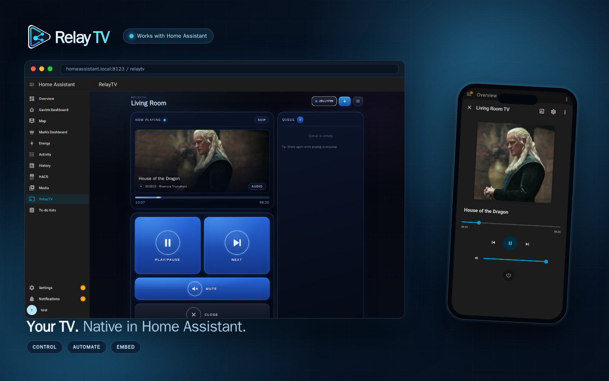
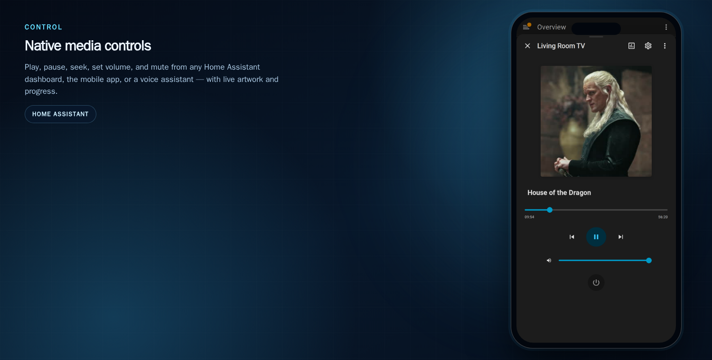
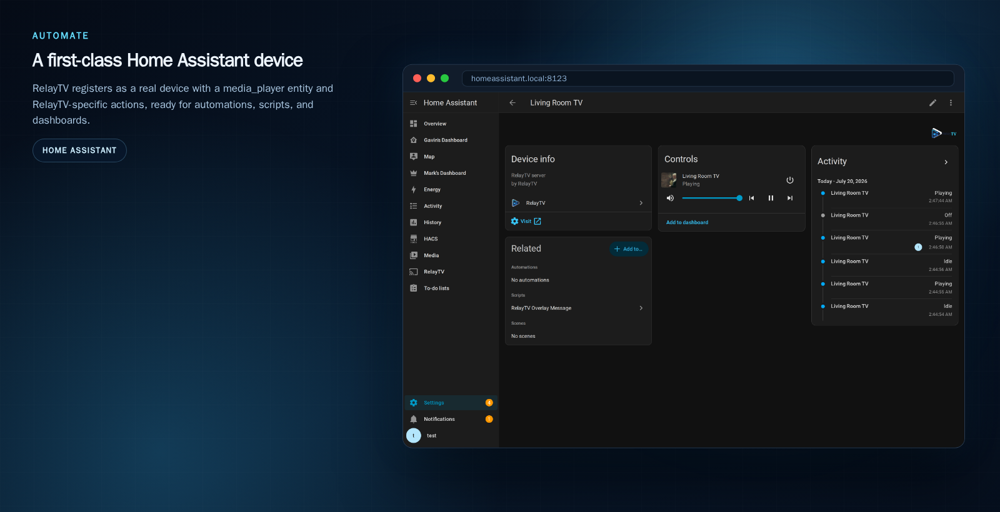
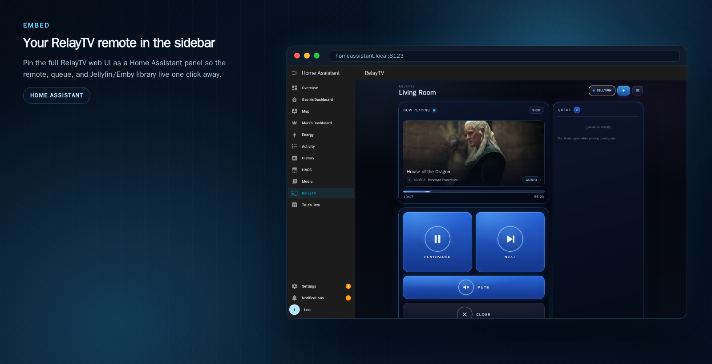

<p align="center">
  
</p>

<h1 align="center">Your TV, native in Home Assistant.</h1>

<p align="center">
  Add your self-hosted RelayTV screens to Home Assistant as real media-player
  devices — control playback, launch media, trigger overlays, and drop RelayTV
  into automations, dashboards, and voice.
</p>

<p align="center">
  <a href="#install-in-minutes"><strong>Install</strong></a> ·
  <a href="#see-it-in-action"><strong>See it in action</strong></a> ·
  <a href="#relaytv-services"><strong>Services</strong></a> ·
  <a href="https://github.com/mcgeezy/relaytv"><strong>RelayTV server</strong></a>
</p>

<p align="center">
  <a href="https://github.com/mcgeezy/relaytv-ha/actions/workflows/tests.yml"></a>
  <a href="https://github.com/hacs/integration"></a>
  <a href="#compatibility"></a>
  <a href="LICENSE"></a>
  <a href="https://buymeacoffee.com/relaytv"></a>
</p>

<p align="center">
  
</p>

<p align="center">
  <strong>Local-first</strong> · No RelayTV account · Bearer-token auth ·
  Credential-safe playback state
</p>

## One integration. Every way you control the TV.

### 🎛️ Control it

Every RelayTV server becomes a Home Assistant `media_player`: play, pause,
stop, next, previous, seek, volume, mute, turn on/off — with live artwork,
title, and progress on your dashboards, the mobile app, and voice assistants.

### 🤖 Automate it

Call RelayTV-specific actions from scripts and automations — smart play,
temporary interrupt-and-resume, overlays, snapshots, synchronized multi-screen
start, and direct uploads from Home Assistant media to the TV.

### 🧩 Embed it

Pin the full RelayTV web UI as a Home Assistant sidebar panel, so the remote,
queue, and Jellyfin/Emby library are always one click away — without leaving
Home Assistant.

RelayTV keeps the playback engine beside the TV while Home Assistant stays the
control plane. Home Assistant automatically prefers RelayTV's versioned local
WebSocket, falls back to its compatible event stream, and keeps `/status`
polling available when neither push transport is healthy.

## See it in action

<p align="center">
  
</p>

<p align="center">
  
</p>

<p align="center">
  
</p>

> The images above are captured from a live Home Assistant instance with
> [`scripts/readme-screenshots.mjs`](scripts/readme-screenshots.mjs).

## Install in minutes

### HACS

1. Open **HACS** in Home Assistant.
2. Add this repository as a custom repository with category **Integration**.
3. Install **RelayTV** and restart Home Assistant.
4. Add the integration from **Settings → Devices & Services → Add Integration**.

### Manual

1. Copy `custom_components/relaytv` into your Home Assistant config:

   ```text
   /config/custom_components/relaytv/
   ```

2. Restart Home Assistant.
3. Go to **Settings → Devices & Services → Add Integration** and search for **RelayTV**.

### Configure

Enter:

- **RelayTV base URL** — for example `http://relaytv-host:8787`
- **Display name** — how this RelayTV instance appears in Home Assistant
- **RelayTV API token** — only if `RELAYTV_API_TOKEN` is enabled on the server

Use **Reconfigure** on the integration entry to change the server address,
display name, or API token. The token is stored in the Home Assistant config
entry and sent only as a bearer authorization header to RelayTV.

From the integration **options** you can also configure:

- `panel_enabled` — enable or disable the sidebar panel
- `panel_target_entry_id` — which RelayTV server the shared panel points at
- `sensor_stream_mappings` — map sensors to temporary playback URLs

## Send links from your phone

Add this automation to relay links shared from the Home Assistant mobile app
straight to the TV:

```yaml
alias: RelayTV - Smart play from share
description: Opens shared URLs/text in RelayTV via relaytv.smart_url
triggers:
  - event_type: mobile_app.share
    trigger: event
conditions:
  - condition: template
    value_template: "{{ shared | trim | length > 0 }}"
actions:
  - data:
      url: "{{ shared | trim }}"
    action: relaytv.smart_url
mode: single
variables:
  shared: |-
    {{ trigger.event.data.url
       if trigger.event.data.url is defined else
       (trigger.event.data.text if trigger.event.data.text is defined else '') }}
```

## RelayTV Services

| Service | RelayTV endpoint | Notes |
| --- | --- | --- |
| `relaytv.smart_url` | `POST /smart` | Smart play/enqueue behavior |
| `relaytv.play_now` | `POST /play` | Immediate playback; clears queue |
| `relaytv.announce` | `POST /play` | Alias of `play_now` |
| `relaytv.play_temporary` | `POST /play_temporary` | Temporary interrupt + resume flow |
| `relaytv.overlay` | `POST /overlay` | Text/image overlay |
| `relaytv.play_synced` | `POST /play_at` | Multi-entity time-aligned start |
| `relaytv.snapshot` | `POST /snapshot` (fallback `GET /snapshot`) | Captures current frame |
| `relaytv.play_with_resume` | `POST /play` + `POST /seek_abs` | Resume per-URL saved position |
| `relaytv.upload_media` | `POST /ingest/media` | Upload local HA media/file and return a RelayTV media URL |
| `relaytv.upload_media_play` | `POST /ingest/media/play` | Upload local HA media/file and start playback |
| `relaytv.upload_media_enqueue` | `POST /ingest/media/enqueue` | Upload local HA media/file and append to queue |

### Example service calls

Smart play / enqueue:

```yaml
service: relaytv.smart_url
target:
  entity_id: media_player.relaytv_living_room
data:
  url: https://www.youtube.com/watch?v=dQw4w9WgXcQ
```

Temporary playback (interrupt, then resume what was playing):

```yaml
service: relaytv.play_temporary
target:
  entity_id: media_player.relaytv_living_room
data:
  url: https://example.com/doorbell-chime.mp3
  timeout: 10
  volume: 0.6
```

Overlay a message on the TV:

```yaml
service: relaytv.overlay
target:
  entity_id: media_player.relaytv_living_room
data:
  text: Front door opened
  duration: 8
  position: top-right
```

Upload a local file and play it:

```yaml
service: relaytv.upload_media_play
target:
  entity_id: media_player.relaytv_living_room
data:
  file_path: /config/www/clip.mp4
  title: Shared Clip
```

`file_path` must be readable by Home Assistant and allowed by
`allowlist_external_dirs`. In the service UI, the `file` field can also select a
local Home Assistant media-source item.

## Typical use cases

- Send shared links from Home Assistant automations to a RelayTV screen
- Upload and play local Home Assistant media files on RelayTV
- Launch temporary doorbell or announcement media, then resume playback
- Display overlay messages on TVs around the home
- Add RelayTV as a dashboard- and voice-accessible media target
- Keep multiple RelayTV devices available in one Home Assistant setup
- Start synchronized playback across more than one RelayTV screen

## Security and upgrading to 0.4.0

Version 0.4.0 sanitizes credential-bearing playback URLs before they reach Home
Assistant state or resume storage. Existing resume data is migrated and limited
to the 500 most recent media keys automatically.

Home Assistant recorder history written by an older version is not rewritten. If
a previous media identifier contained an upstream Jellyfin/Emby API key or
signed URL, rotate that credential and consider purging old history for the
RelayTV media-player entity.

For defense in depth, update the RelayTV server to a version that redacts
private playback fields from public status, queue, history, and SSE payloads.
The matching server update also lets Home Assistant process RelayTV thumbnails
across origins without browser CORS errors.

## Known limitations

- `relaytv.play_now` maps to RelayTV `POST /play` (queue-clearing behavior);
  the server's preserve-current `POST /play_now` is not yet used
- No dedicated `clear_queue` Home Assistant service is registered
- Upload services require a local media-source item or a file path available
  inside the Home Assistant container
- Overlay calls must include at least `text` or `image_url`
- Snapshots require active playback on the RelayTV server
- Realtime capability discovery prefers `/ui/ws`, falls back to `/ui/events`,
  and retains `/status` as the reconnect/bootstrap and outage fallback
- Push streams are live snapshots, not replay logs; a reconnect or sequence
  gap causes an authoritative `/status` refresh
- Releases predating `POST /auth/check` remain compatible, but the current
  server release is recommended for public-payload redaction and cross-origin
  thumbnails

## Companion projects

- **[RelayTV server](https://github.com/mcgeezy/relaytv)** — the local playback
  engine and web UI.
- **[RelayTV for Android](https://github.com/mcgeezy/relaytv-android)** — share
  links directly to the TV and control playback from your phone.

### Planned / work in progress

- iPhone companion app
- Continued multi-device and automation improvements
- Ongoing UX polish across the RelayTV ecosystem

## Compatibility

RelayTV HA 0.4.0 and newer require **Home Assistant 2026.7 or newer** and are
automatically tested against Home Assistant 2026.7.2 and the current RelayTV
server API.

For local verification:

```bash
python -m pip install --requirement requirements_test.txt
ruff check custom_components tests
python -m pytest -q
```

Before publishing an integration release, complete the
[release checklist](docs/RELEASE_CHECKLIST.md), including current-server,
legacy-server, proxy fallback, reload, reconfiguration, and outage recovery
cases.

To regenerate the README images from a live Home Assistant instance:

```bash
HA_TOKEN=<long-lived-token> node scripts/readme-screenshots.mjs \
  --ha=http://homeassistant.local:8123 \
  --device=<relaytv_device_id> \
  --entity=media_player.living_room_tv \
  --ws=ws://127.0.0.1:3000/
```

## Releases

RelayTV HA releases are tag-driven. Merging a pull request does not publish a
GitHub or HACS release; a maintainer pushes an annotated `vX.Y.Z` tag only after
the matching manifest version is merged and all `main` checks pass. The release
workflow rejects mismatched tags, builds the flat `relaytv.zip` HACS archive,
and publishes it with `RELEASE_NOTES.md`.

Maintainers should follow the complete
[release checklist](docs/RELEASE_CHECKLIST.md). Published tags are immutable;
release corrections use a new patch version rather than moving an existing
tag.

## Support the project

If RelayTV is useful to you, donations help fund continued development of the
server, this Home Assistant integration, the Android app, and future companion
apps.

Buy me a coffee: https://buymeacoffee.com/relaytv

## License

RelayTV Home Assistant is licensed under the GNU General Public License, version
3 only (`GPL-3.0-only`). See [LICENSE](LICENSE).
